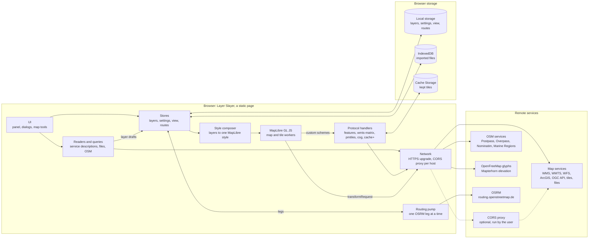
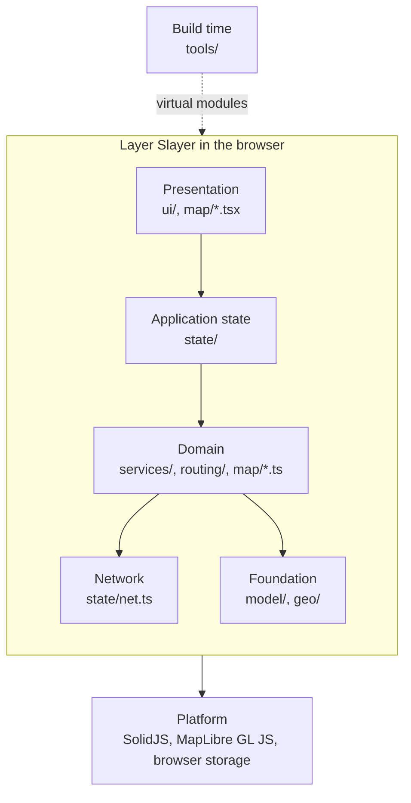
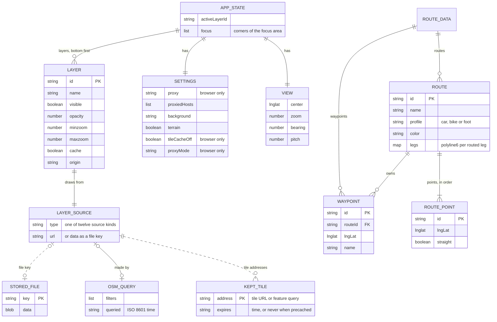

# Architecture

## High-level architecture

Everything runs in the browser. The remote services are the map services a user adds and
the public services the app asks itself. The dotted path is the optional CORS proxy.

## Block diagram

| Layer | Contents |
|---|---|
| Presentation | The panel and its dialogs (`ui/`); the map view, toolbar, route editor, context menu and search box (`map/*.tsx`). |
| Application state | The layer store with settings, view and focus area; the route store with undo and redo; local storage, stored files and project files (`state/`). |
| Domain | Service readers and file import (`services/`); route edits, legs and the OSRM pump (`routing/`); style composition, overlays, protocol handlers, feature tiles and the tile cache (`map/*.ts`). |
| Network | HTTPS upgrade, the per-host CORS proxy and readable errors for every request but routing (`state/net.ts`). |
| Foundation | Layer, route and icon types (`model/`); Web Mercator, bounds and geometry (`geo/`). |
| Build time (secondary) | Vite plugins that serve the service library and the icon sets as virtual modules (`tools/`). |
| Platform (secondary) | SolidJS, MapLibre GL JS, local storage, IndexedDB, Cache Storage. |

The arrows show the main direction of use. The layers follow responsibility and are not
enforced on imports: upper layers also use lower ones directly, and some domain modules
read the stores.

## Persisted data

| Data | Kept in |
|---|---|
| APP_STATE with its layers, settings and view | Local storage, key `layerslayer` |
| ROUTE_DATA with its routes and waypoints | Local storage, key `layerslayer-routes` |
| STORED_FILE | IndexedDB, database `layerslayer`, store `files` |
| KEPT_TILE | Cache Storage, cache `layerslayer-tiles-v2` |

A project file (`.lslay`) is a ZIP archive of APP_STATE without the browser-only settings,
ROUTE_DATA, and the stored files of its layers.
